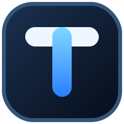

<p align="center"></p>

# Trendo OS

**Status: P1 ACCEPTED (21.10.2026, mit offenen Punkten), P2 in Arbeit.** Ein erster Windows-Vertical-Slice (.NET 10 + Avalonia) baut ohne Warnungen und besteht 60 Tests (39 Core, 14 API, 7 UI) auf Windows; lokale API nur auf 127.0.0.1 mit Rollen-Tokens (siehe `reports/P1_TESTBERICHT.md`). Ein Benutzer-Installer ohne Adminrechte existiert (`installer/`); noch kein Release.

Trendo OS ist ein geplantes, lokal arbeitendes, KI-unterstütztes Arbeits- und Produktionssystem mit dem integrierten Assistenten **Trendo**. Ein Produkt, drei Editionen:

1. **Native Windows-App** – ohne Raspberry Pi, ohne Ersatz von Windows-Shell/Taskleiste.
2. **Bootbares Linux auf externer SSD/USB** (bevorzugt: *Full Studio auf externer SSD*) – ohne Pi.
3. **Raspberry Pi 4 (8 GB) + Windows-PC** – Pi koordiniert, PC rechnet (GPU, Blender, Unreal).

## Rollen
- **Grok Bot** – Projektleitung, Planung, Aufgaben, Review (Cloud).
- **Grok Build** – lokaler Programmier-/Test-Agent auf dem Windows-PC (Einrichtung noch nicht verifiziert).
- **Manuel** – Freigaben, Hardware, Merge und Release.

## Struktur
| Pfad | Inhalt |
|---|---|
| `docs/spec/` | Verbindliche Spezifikation v2.1 (Systembibel, Architektur, Roadmap, Modulregister, offene Entscheidungen) |
| `docs/spec/studios/` | Online-Business-Studio (30) und Brief-Studio (25) |
| `docs/spec/qa/` | Abnahmekriterien und Testmatrizen (alle `NOT_RUN`) |
| `docs/spec/grok/` | Grok-Bot/Grok-Build-Prompts, Setup, Agenten-/MCP-Architektur |
| `docs/design/` | Designbrief und **Konzeptbild** (Demodaten, Logo nicht freigegeben) |
| `docs/adr/` | Architekturentscheidungen (ADRs) |
| `requirements.yaml` | Maschinenlesbare Anforderungen, erzeugt aus den CSVs |
| `tasks/` | Aufträge an Grok Build |
| `reports/` | Statusberichte und Testnachweise |
| `src/`, `tests/` | Trendo.Core, Trendo.App (Avalonia), xUnit-Tests |
| `scripts/` | Generator und Validierung für `requirements.yaml` |

## Bauen und testen
```bash
dotnet build Trendo.sln -c Release
dotnet test Trendo.sln -c Release
dotnet run --project src/Trendo.App -c Release
```

## Windows-Paket (ohne Admin)
```powershell
powershell -ExecutionPolicy Bypass -File installer\build-package.ps1
powershell -ExecutionPolicy Bypass -File artifacts\TrendoOS-win-x64\install.ps1
# Deinstallation: %LOCALAPPDATA%\Programs\TrendoOS\uninstall.ps1
```

## Validierung
```bash
pip install -r scripts/requirements.txt
python scripts/generate_requirements.py   # requirements.yaml neu erzeugen
python scripts/validate_requirements.py   # Konsistenz prüfen
```
Die Validierung prüft nur die Spezifikation, nicht die Software.

## Statusmodell
`PROPOSED → APPROVED_SPEC → PLANNED → IN_PROGRESS → IMPLEMENTED → TESTED → ACCEPTED → RELEASED`, dazu `FAILED`/`BLOCKED`. Statuswechsel nur mit echten Artefakten und Logs.

## Wichtig
- Dieses Repository ist **öffentlich**: niemals Secrets, Zugangsdaten, persönliche Daten oder forensische Kopien committen.
- Keine externen Aktionen, Käufe, Veröffentlichungen oder Windows-/Treiber-/Firmware-Änderungen ohne ausdrückliche Freigabe.
- Die Erweiterung *Language & Localization Studio 2.0* wurde abgelehnt und wird nicht umgesetzt.
